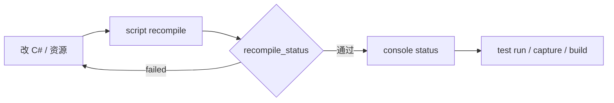

# com.unity.pipeline · Unity 2022.3 兼容分支

把 Unity 编辑器（或开发版 Player）变成一个可以被程序驱动的本地服务：`unity` CLI 连上去，读状态、跑 C#、重编译、截图、构建、跑测试。

这个仓库是 [Unity Pipeline 1.0.0](https://docs.unity3d.com/Packages/com.unity.pipeline@1.0/manual/index.html) 的回迁分支，最低支持 **Unity 2022.3**，同时保留 Unity 6 的代码路径。上游 revision `ce87150`，原始包未做改动。

- 兼容改动与实测记录：[Documentation~/unity-2022-compatibility.md](Documentation~/unity-2022-compatibility.md)
- 完整命令参考：[Documentation~/command-reference.md](Documentation~/command-reference.md)
- 连接与排错：[Documentation~/connectivity.md](Documentation~/connectivity.md)

---

## 环境要求

| 项目 | 要求 |
| --- | --- |
| Unity | 2022.3（实测 2022.3.60f1c1）；Unity 6 路径保留，但本分支未在 Unity 6 上编译验证 |
| CLI | Unity CLI 1.0.0+ |
| 平台 | 仅在 Windows 上实测；macOS / Linux 的 CLI 命令相同，但未验证 |
| 渲染 | 2022 + URP 14 下 Scene View 摄像机截图不可用，用 `source=screen` 代替 |

---

## 安装

### 1. 安装 Unity CLI

Windows（PowerShell）：

```powershell
irm https://unity.com/install.ps1 | iex
unity --version
```

macOS / Linux：

```bash
curl -fsSL https://unity.com/install.sh | bash
unity --version
```

装完重开一个终端，确认 `unity` 在 PATH 上。

### 2. 把包放进工程

**方式 A：嵌入工程（推荐）**

把本仓库整个目录复制到工程的 `Packages/com.unity.pipeline`。保留所有 `.meta` 文件，不要复制 `Library/`、`Temp/`。

```text
MyProject/
└── Packages/
    └── com.unity.pipeline/   ← 本仓库
```

嵌入包由 Unity 直接发现，`packages-lock.json` 会记录为 `file:com.unity.pipeline`，不需要改 `manifest.json`。

**方式 B：UPM git 依赖**

在 `Packages/manifest.json` 里加：

```json
{
  "dependencies": {
    "com.unity.pipeline": "https://github.com/3038665474qq/com.unity.pipeline-2022-unity6.git"
  }
}
```

> ⚠️ 不要用 `unity pipeline install` 安装这个分支。它会把官方 registry 版本装回来，覆盖这里的 2022 兼容改动。私有仓库走 git 依赖还需要在 UPM 里配置凭据。

### 3. 打开工程

```powershell
unity open "C:\path\to\MyProject"
unity status --until-ready --project-path "C:\path\to\MyProject"
```

`status` 返回 `ready`、端口 `7800`、编辑器版本，就说明 Pipeline 服务已经起来了。

> **Windows 启动前置**：2022 的 Package Manager 需要进程里有 `ALLUSERSPROFILE`，缺了会报
> `The "path" argument must be of type string. Received undefined`。在启动 Unity 的同一个 shell 里先执行：
>
> ```powershell
> $env:ALLUSERSPROFILE = $env:ProgramData
> ```

---

## 第一次连接：用四个返回值验收

```powershell
$env:ALLUSERSPROFILE = $env:ProgramData
$project = "C:\path\to\MyProject"

unity status --until-ready --project-path $project
unity command console status --project-path $project
unity command script eval "1 + 1" --project-path $project
unity command script recompile_status --project-path $project
```

期望结果：

| 命令 | 期望 |
| --- | --- |
| `status --until-ready` | `ready`，端口 `7800`，版本 `2022.3.x` |
| `console status` | `compilationFailed=false`，`consoleErrors=0` |
| `script eval "1 + 1"` | `2` |
| `script recompile_status` | `completed`（或 `up_to_date`），`failed=false`，`errors=[]` |

`1 + 1 = 2` 看着像玩笑，它同时证明：CLI 找到了编辑器、端口通、协议对、脚本编译能跑、编辑器主线程没卡死。

---

## 日常操作

核心循环只有一条：



下面每条都可以直接复制。所有命令都建议带 `--project-path`，尤其是同时开了多个编辑器的时候。

### 读编辑器状态

```powershell
unity status --project-path $project
unity command editor status --project-path $project
```

`editor status` 会返回编辑器是否聚焦、是否有模态对话框挡着（`blocked_by_dialog`）。卡住的时候先看它。

### 执行一段 C#

```powershell
# 一行流
unity command script eval "return Application.unityVersion;" --project-path $project

# 需要 using 或多个语句
unity command script eval "using Random = UnityEngine.Random; return Random.Range(1, 7);" --project-path $project

# 读编辑器内部 API（如 Console 计数）
unity command script eval "return UnityEditor.LogEntries.GetCount();" --internals --project-path $project
```

- 代码走的是编辑器的编译环境，`UNITY_EDITOR` 等符号都在。
- 复杂逻辑不要塞进 `eval`，写成文件用 `script run`。

### 跑工程内脚本（builder 模式）

把脚本放在 `Assets/` 外面，避免每次写入触发资源导入和域重载：

```text
MyProject/
└── AgentScripts/
    └── Build.cs        // public static class Build { public static int All() { ... } }
```

```powershell
unity command script run --file AgentScripts/Build.cs --entry Build.All --project-path $project
unity command script run --file AgentScripts/Build.cs --entry Build.All --dry-run --project-path $project
```

这是批量操作的首选：编译在内存里完成，量级是秒，不用重启编辑器。`--dry-run` 只编译、不执行，用来先看诊断。

### 改代码 → 重编译 → 读结果

```powershell
unity command editor set_auto_tick --enable true --project-path $project
unity command script recompile --project-path $project
unity command script recompile_status --project-path $project
```

- `recompile` 是异步的，会触发域重载；重载期间 CLI 可能短暂连不上，属正常。
- 轮询 `recompile_status` 到 `completed` / `up_to_date` 为止。
- 失败时读 `failed` 和 `errors[]`，不要靠肉眼看 Console。
- 编译没过就不要往下跑测试和构建——把它当门禁。
- `set_auto_tick` 是给无人值守会话用的：编辑器不在前台时 Unity 会限速，重编译可能挂住。验证完记得关掉：

```powershell
unity command editor set_auto_tick --enable false --project-path $project
```

### 读 Console

```powershell
unity command console status --project-path $project
unity command console get --level error --project-path $project
```

`console status` 是**当前状态**，`console get` 是**历史条目**。历史上留着的红字（比如上一次构建失败）不代表现在的编译是坏的——脚本判断时读 `status`。

### 场景与层级

```powershell
unity command scene list_open --project-path $project
unity command scene get_hierarchy --project-path $project
```

### 截图验收

```powershell
# 抓当前已经渲染出来的 Scene 窗口（2022 + SRP 用这个）
unity command capture scene_view --source screen --output-path Temp/scene.png --project-path $project

# 抓 Console 窗口
unity command capture editor_window --window ConsoleWindow --output-path Temp/console.png --project-path $project
```

> 2022 + URP 14 下，`capture scene_view` 的**摄像机来源**会在 `Render2DLightingPass` 抛空引用，虽然仍会生成 PNG，但那不是有效截图。本分支在这种组合下直接拒绝，并提示改用 `source=screen`。

### Play Mode

```powershell
unity command editor.playmode start --project-path $project
unity command editor.playmode stop --project-path $project
```

### 构建

```powershell
# 先验证目标与场景，不真的构建
unity command build run --target StandaloneWindows64 --dry-run true --project-path $project

# 正式构建（必须显式 confirm）
unity command build run --target StandaloneWindows64 --confirm true --project-path $project

# 轮询结果
unity command build status --project-path $project
```

`build run` 只负责排队，真正的构建在编辑器 tick 里跑；`build status` 一直轮询到 `completed`，会带回完整 BuildReport（错误数、耗时、产物）。

> 首次构建如果在 Burst 链接阶段报“创建临时响应文件被拒绝”，把当前 Editor 进程的 `TEMP` / `TMP` 指到工程内可写目录再重试。不要改系统环境变量。

### 测试

```powershell
unity command test list --mode editor --project-path $project
unity command test run --mode editor --filter-type category --filter Smoke --project-path $project
unity command test status --project-path $project
```

CLI 的退出码要分清入口：`unity test` 用退出码 `8` 表示“测试跑完了但有用例失败”；`unity command test run` 属于 Pipeline 命令，失败以退出码 `6` 返回。

> 注意：`test run` 能执行，不代表有测试被选中。没有测试程序集时它会“成功”地跑 0 个用例——这不能写成“测试通过”。

### 连接到开发版 Player（可选）

```powershell
# 按 Player 进程名
unity command --runtime MyGame.exe runtime status

# 按端口文件所在目录（Windows 指向 exe 所在目录；macOS 指向 .app）
unity command --runtime-path "C:\Builds\MyGame" runtime status
```

Runtime 服务只在**开发版 Player**、且工程启用了 Runtime Pipeline 时才存在；本仓库的验证工程未启用，见“已知限制”。

### 发现命令

```powershell
unity command                        # 列出当前编辑器暴露的命令组
unity command --query screenshot     # 按词搜索命令（含未安装的插件）
unity commands --grep license        # 搜 CLI 内置命令、插件与当前编辑器的 Pipeline 命令
```

不要靠猜命令名，编辑器自己知道答案。

---

## 命令速查

| 目的 | 命令 |
| --- | --- |
| 等编辑器就绪 | `unity status --until-ready --project-path <p>` |
| 列出命令组 | `unity command --project-path <p>` |
| 执行一行 C# | `unity command script eval "<code>"` |
| 跑工程内脚本 | `unity command script run --file <f> --entry <T>` |
| 触发重编译 | `unity command script recompile` |
| 读编译结果 | `unity command script recompile_status` |
| 读 Console 状态 | `unity command console status` |
| 读错误条目 | `unity command console get --level error` |
| 场景状态 | `unity command scene list_open` |
| 截 Scene 窗口 | `unity command capture scene_view --source screen --output-path <png>` |
| 截 Console 窗口 | `unity command capture editor_window --window ConsoleWindow --output-path <png>` |
| 进/出 Play Mode | `unity command editor.playmode start` / `stop` |
| 保持 tick | `unity command editor set_auto_tick --enable true` |
| 构建（验证） | `unity command build run --target <t> --dry-run true` |
| 构建（执行） | `unity command build run --target <t> --confirm true` |
| 构建结果 | `unity command build status` |
| 测试 | `unity command test run --mode editor --filter <f>` |

脚本里解析输出时统一加 `--format json`，读 `success` 和 `errors[0].code`，不要解析人类可读文本。

---

## 兼容性边界

| 能力 | Unity 2022.3 | Unity 6 | 说明 |
| --- | --- | --- | --- |
| CLI 连接、心跳、命令目录 | ✅ | ✅ | 端口 7800 |
| `script eval` / `script run` | ✅ | ✅ | |
| 重编译与编译状态 | ✅ | ✅ | |
| Console 状态与条目 | ✅ | ✅ | 2022 走 `LogEntries` 反射 |
| 场景 / GameObject / 材质 / 资源检索 | ✅ | ✅ | |
| 截图（Console、Scene screen） | ✅ | ✅ | |
| 构建与构建报告 | ✅ | ✅ | 2022 用当前 Build Target + `EditorBuildSettings` |
| 测试命令 | ✅ | ✅ | 上游未附带 `com.unity.pipeline.tests` |
| Build Profiles | ❌ | ✅ | 2022 返回明确的版本要求 |
| Scene Preview | ❌ | ✅ | 2022 编译期排除 |
| 多人角色 / Play Mode Scenario | ❌ | ✅ | 需要 Unity 6 + MPPM 包 |
| Analytics 发送 | ⚠️ 仅本地 | ✅ | 不向 Unity Analytics 发送 |
| Scene View 摄像机截图 | ❌ | ✅ | 2022 + SRP 会渲染异常，改用 `source=screen` |
| Input System 键鼠注入 | ⚠️ 未实测 | ✅ | 独立可选程序集，装包并启用才编译 |
| Runtime Player 连接 | ⚠️ 未启用 | ✅ | Player 侧需开启 Runtime Pipeline |

---

## 设计约定

这个分支在“失败”这件事上比较啰嗦，是有意的：

- **不发布假数据**。Console 计数走反射，反射失败时状态是“未知”，不是 `0`。一个假的零会让下游把它当基线，一路传下去。
- **不支持就明确拒绝**。Build Profiles、SRP 摄像机截图这些，返回版本要求和原因，而不是静默返回空结果。
- **截图要可信**。能生成 PNG 不等于截到了图；渲染中途抛异常的产物会被拒绝，而不是交付出去。

对人和对 agent 都一样：返回值必须是可判断的。

---

## 故障排查

| 现象 | 原因 / 处理 |
| --- | --- |
| Package Manager 报 `path argument must be of type string` | shell 缺 `ALLUSERSPROFILE`，设 `$env:ALLUSERSPROFILE = $env:ProgramData` |
| `status` 一直等不到 ready | 先看编辑器是否在 Safe Mode（有编译错误时 Pipeline 不加载），修错误而不是重试连接 |
| 命令超时、连接断开 | 可能在域重载；等重载结束再试。多个编辑器时用 `--project-path` 指定 |
| 命令卡住但 `editor status` 正常 | 检查是否有模态对话框：返回 `blocked_by_dialog`，CLI 点不了，需要人去关 |
| Scene 截图报错 | 2022 + URP 14 用 `--source screen`，不要用摄像机来源 |
| 构建在 Burst 阶段失败 | 当前进程 `TEMP` / `TMP` 指向工程内可写目录后重试 |
| 重编译/测试莫名挂起 | 先 `editor set_auto_tick --enable true` |

---

## 目录结构

```text
com.unity.pipeline/
├── Editor/                 编辑器侧命令与实现
├── Runtime/                运行时（Player）侧
├── CodeGen/                代码生成
├── Documentation~/         包文档（含 2022 兼容说明）
├── package.json
├── CHANGELOG.md
└── LICENSE.md
```

---

## 已知限制

- 本分支未在 Unity 6 编辑器上编译验证；Unity 6 路径是“按原样保留”，不是“跑通过”。
- Input System 注入未在装有该包的项目中实测。
- Runtime Player 连接未实测（验证工程未启用 Runtime Pipeline）。
- 上游没有附带测试程序集，不能声称测试套件通过。

---

## 来源与许可

- 基于 Unity Pipeline 1.0.0，revision `ce87150fe76742893213dac8aa3fac1a3fadf577`。
- 上游原始包未修改，本仓库是独立的兼容分支，改动都集中在 `#if` 分支与兼容文档里。
- 许可与第三方声明见 [LICENSE.md](LICENSE.md) 与 [Third Party Notices.md](Third Party Notices.md)；上游条款见 [Unity Terms of Service](https://unity.com/legal/terms-of-service)。
